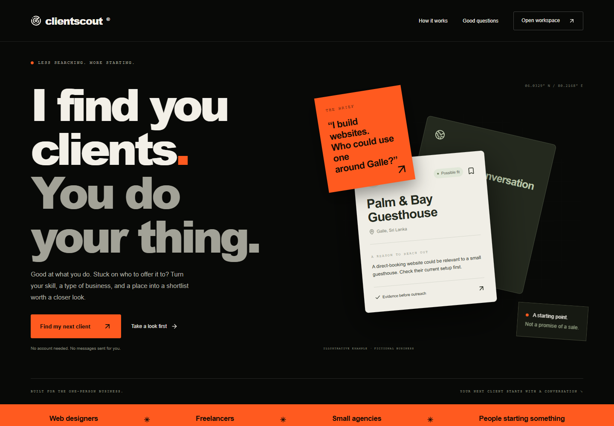

# ClientScout

**I find you clients. You do your thing.**

You can know exactly what you want to sell and still have no idea who to offer it to. ClientScout takes your offer, a type of business, and a location, then builds a small shortlist of potential customers with a reason to look closer.

Think websites for guesthouses in Galle, photography for cafés in Colombo, or bookkeeping for independent shops. It helps with the research before the first conversation. It doesn't promise anyone wants to buy.

[Open ClientScout](https://clientscout-akrc.onrender.com) · [Explore the example workspace](https://clientscout-akrc.onrender.com/app?demo=1)



## Try it

The landing page is at `/`. The workspace is at `/app`. Choose **Take a look first** for an example with clearly labelled fictional businesses. That works without API keys.

For live searches:

```sh
npm ci
cp .env.example .env.local
# Add your own server-side API keys to .env.local
npm run dev
```

Open [localhost:3000](http://localhost:3000). Use Node.js 22.13 or newer; Node 24 is recommended.

| Variable | What it does |
| --- | --- |
| `GEMINI_API_KEY` | Google AI API key for Gemini and hosted Gemma |
| `SERPAPI_API_KEY` | Live Google Maps business listings |
| `GEMINI_MODEL` | Profile extraction model; defaults to `gemini-3.8-flash` |
| `GEMMA_MODEL` | Open-weight relevance reviewer; deployed configuration uses `gemma-4-26b-a4b-it` |
| `SEARCH_DAILY_LIMIT` | Shared searches per process per 24-hour window; defaults to 20 |
| `PORT` | Production port, supplied automatically by Render |

Keys stay on the server. Never add `NEXT_PUBLIC_` to them. `.env.local` is ignored by Git. Optional Gemini keys entered in the workspace stay in memory for that tab and pass through the server to Google. Search and model providers may charge for usage.

## What happens when you search

1. SerpApi retrieves public Google Maps listings for the audience and place. The app keeps names, addresses, categories, websites, phone numbers, and source references.
2. Gemini turns those records into structured profiles relevant to your offer. Code matches each profile back to an exact listing and takes contact fields from that listing. Model-generated contacts are discarded. This path doesn't collect email addresses.
3. Gemma reviews relevance and writes a tentative opening plus what you still need to check. It cannot change business names, websites, phone numbers, or sources. If the configured review fails, the search fails visibly.
4. You review the evidence, save useful prospects in your browser, export a CSV, or edit and copy an English outreach template. Nothing is sent automatically.

Without a SerpApi key, the app can use Gemini Search grounding instead. Without `GEMMA_MODEL`, it skips the open-model review. Those are development options; the hosted configuration enables both. This is hosted inference, not offline AI.

A **Strong** fit means the business activity appears relevant to the offer. It says nothing about budget, interest, or purchase probability. A missing website field doesn't prove a business has no website. Listings can be wrong or stale, and a requested region doesn't guarantee every result is inside it. Check the sources before contacting anyone.

## Built with

Next.js App Router, React, TypeScript, Zod, Lucide, and plain CSS. No separate backend and no database. Saved lists and the last brief live in browser storage on that device, so export anything you want to keep.

The visual direction comes from the Axisform template in the supplied template collection: charcoal, orange, oversized type, and layered cards. It's rebuilt as local React components and CSS, without its animation scripts or external image dependencies.

## Deploy on Render

`render.yaml` defines a free Node web service. Supply your own Gemini and SerpApi keys in Render's environment settings, then deploy. The build runs `npm ci --include=dev && npm run build`; `npm start` binds to `0.0.0.0` on Render's `PORT`. Health checks use `/api/status`, which exposes configuration status only.

The public demo allows two concurrent searches and a small shared daily allowance. These counters are in memory and reset when the process restarts. They are not durable billing protection or per-user authentication. Set hard provider quotas before exposing your own keys, and add durable quotas/authentication before running this as a paid product. Free Render instances may sleep when idle.

## Check the build

```sh
npm run typecheck
npm test
npm run build
```

Tests cover source validation, unsupported contact removal, CSV formula protection, request validation, and upstream failures. Live searches need working provider quotas; a mocked test doesn't establish that a business wants your service.

## Still to build

A paid account system, durable saved lists and budgets, contact freshness checks, and feedback from people doing real outreach. There are no claimed customers or revenue yet. This is a working starting point for a side hustle, with the uncertain parts left visible.

